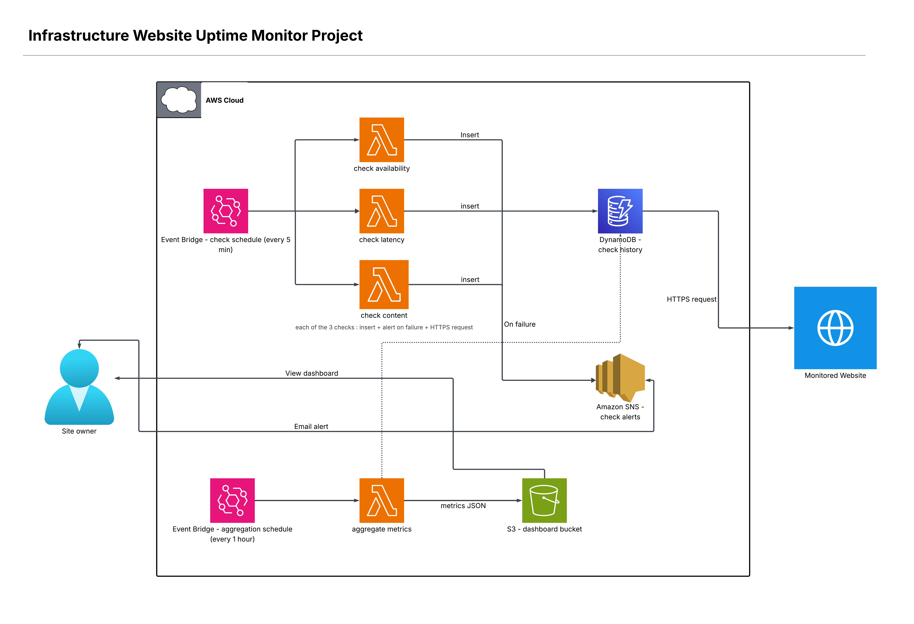
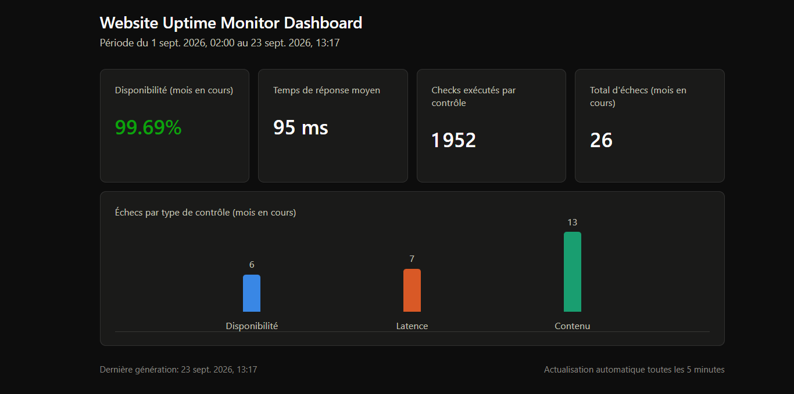
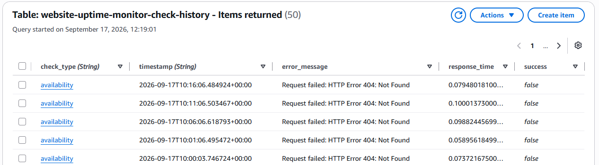

# Website Uptime Monitor

Website Uptime monitor is a serverless monitoring system for a website build with AWS and Terraform only. It is part of my personal project on AWS during my 5th year degree as computer science student to learn more about AWS architecture and Iac notions.

## Problem

One of the most fear for a website owner it's that it break down with anyone being aware of at time which considerally impact global cost and reputation of regularly customer and the potenital new. This project realize several check for the target website at regular intervals. Then it records each result and aler the owner within second as soon as a problem has been detected.

## What it does

Three checks run on the monitored website. One check if it's up one check how fast it load and one check if it show the right content. If one fail an SNS alert get sent right away by email. Every result get saved in DynamoDB with the timestamp the response time and the status so it build an history over time.

A fourth Lambda aggregate_metrics read this history and push a JSON file to S3 to feed a small dashboard with metrics like the availability percentage and the average response time.
## Architecture

The diagram below represent the whole system from the check scheduling to the three Lambda functions the history storage the alert system and the dashboard feed.

## Results

This is the dashboard on 23 September 2026. The failures come from my manual tests, where I broke the site on purpose.

When a check fails, an email is sent with the reason, here a 404 on the availability check.

Every check is saved in DynamoDB, so the history stays available.

## Stack

AWS services used: Lambda DynamoDB SNS S3 and EventBridge. No server to manage. Terraform handle the infrastructure with a remote state on S3 and a lock table on DynamoDB. The Lambdas are written in Python everything is on GitHub and the diagram was made with LucidChart.
## Testing

The three checks and the aggregate_metrics Lambda got tested manually by breaking the monitored website on purpose and check that the alert and the history worked like expected. The least-privilege IAM policy was tested the same way by removing AdministratorAccess and fixing every AccessDenied error that showed up.

On top of that there is 22 automated tests with pytest and moto across the 4 Lambdas and the shared incident logic. They replay the same situation in about 10 seconds instead of several minutes run on a fake AWS so nothing real get touched and run automatically on every push and pull request with GitHub Actions see [ci-check.md](docs/testing/automated/ci-check.md).

Incident management the feature just finished group the alerts from several checks failing at the same time into one single notification instead of one email per check. It got tested the same way than the Lambdas by breaking the site and check the result end to end see [testing-incident-management.md](docs/testing/manual/testing-incident-management.md).
## Status

The project is finished as a v1 built step by step check the commit history for the detail. The three checks the alerting the history the incident deduplication and the dashboard all work end to end. IAM least-privilege is done too, and 22 automated tests run on every push and pull request through a GitHub Actions workflow so a broken change get caught right away. The monitored website has real content on 4 pages you can visit it [here](http://website-uptime-monitor-site.s3-website-eu-west-1.amazonaws.com).

A better version is coming see the limitations below.
## Known limitations

The dashboard uses plain HTTP there is no CloudFront in front of the S3 bucket yet. The Terraform deployer user is also the IAM user for the console login so a manual change outside Terraform is still possible.

The deployer can also change its own permissions because Terraform need this to manage the deployer policy and the Lambda roles. It means if the access keys leak an attacker could give AdministratorAccess back to itself. A permissions boundary would fix this not done here because it add a lot of complexity for this project size.

The automated tests don't cover everything. The pagination in aggregate_metrics (the loop that read DynamoDB again when the answer is bigger than 1 MB) is not tested simulating it was too complex for this project so far. The real AWS side (IAM rights EventBridge real emails) is only checked by the manual tests.
## Author

Maxime Hochereau, final year computer science engineering student.
