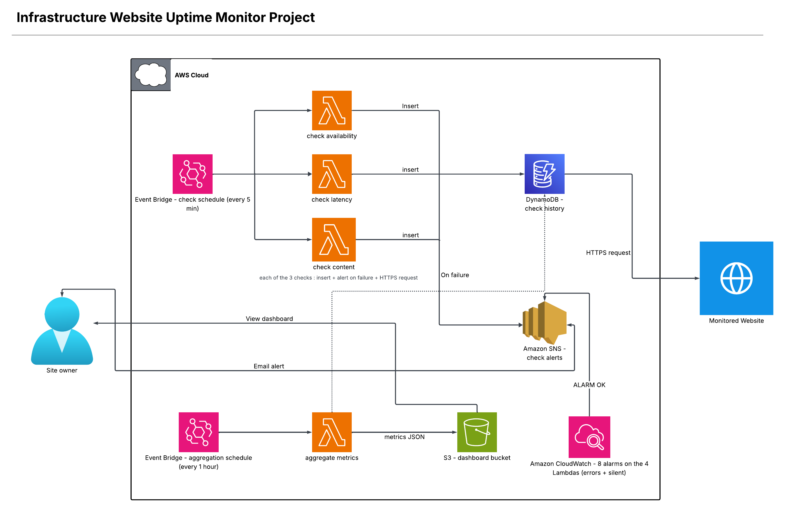
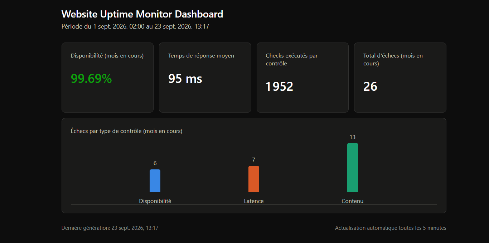

# Website Uptime Monitor

Website Uptime monitor is a serverless monitoring system for a website build with AWS and Terraform only. It is part of my personal project on AWS during my 5th year degree as computer science student to learn more about AWS architecture and Iac notions.

## Problem

One of the most fear for a website owner it's that it break down with anyone being aware of at time which considerally impact global cost and reputation of regularly customer and the potenital new. This project realize several check for the target website at regular intervals. Then it records each result and aler the owner within second as soon as a problem has been detected.

## What it does

Three checks run on the monitored website. One check if it's up one check how fast it load and one check if it show the right content. Every result get saved in DynamoDB with the timestamp the response time and the status so it build an history over time.

When a check fail an alert is sent by email through SNS. If several checks fail at the same time they are grouped in one incident. You get one email when it open and one email when it is solved. CloudWatch alarms also watch the 4 Lambdas so a crash or a silent Lambda is never missed.

A fourth Lambda aggregate_metrics read the history and push a JSON file to S3 to feed a small [dashboard](http://website-uptime-monitor-dashboard.s3-website-eu-west-1.amazonaws.com) with metrics like the availability percentage and the average response time.

## Architecture

The diagram below represent the whole system from the check scheduling to the three Lambda functions the history storage the alert system the alarms and the dashboard feed.

## Results

This is the dashboard on 23 September 2026. The failures come from my manual tests where I broke the site on purpose.

## Stack

AWS services used: Lambda DynamoDB SNS S3 EventBridge and CloudWatch. No server to manage. Terraform handle the infrastructure with a remote state on S3 and a lock table on DynamoDB. The Lambdas are written in Python everything is on GitHub and the diagram was made with LucidChart.

## Testing

The three checks and the aggregate_metrics Lambda got tested manually by breaking the monitored website on purpose and check that the alert and the history worked like expected. The least-privilege IAM policy was tested the same way by removing AdministratorAccess and fixing every AccessDenied error that showed up.

On top of that there is 22 automated tests with pytest and moto across the 4 Lambdas and the shared incident logic. They replay the same situation in about 10 seconds instead of several minutes run on a fake AWS so nothing real get touched and run automatically on every push and pull request with GitHub Actions see [ci-check.md](docs/testing/automated/ci-check.md).

Incident management group the alerts from several checks failing at the same time into one single notification instead of one email per check. It got tested the same way by breaking the site and check the result end to end see [testing-incident-management.md](docs/testing/manual/testing-incident-management.md).

The CloudWatch alarms got tested by crashing a Lambda on purpose and wait for the ALARM email then the OK email after the fix see [testing-lambda-alarm.md](docs/testing/manual/testing-lambda-alarm.md).

## Status

Everything work end to end. The three checks the alerting the history the incident grouping and the dashboard are all running. IAM follow least-privilege and 22 automated tests run on every push and pull request through GitHub Actions so a broken change get caught right away. CloudWatch alarms watch the 4 Lambdas so a crash is never silent.

The monitored website has real content on 4 pages you can visit it [here](http://website-uptime-monitor-site.s3-website-eu-west-1.amazonaws.com).

## Design choices

The dashboard uses plain HTTP because the S3 website endpoint does not support HTTPS. It is public and read only and it show only availability numbers so nothing sensitive goes through. CloudFront would add HTTPS but it is more infrastructure than this project need.

The Terraform deployer is also the IAM user for the console login. It is a personal account with one person so one identity keep things simple. Changes go through Terraform and the plan show any difference with the real infrastructure.

The deployer can change its own permissions because Terraform need this to manage the deployer policy and the Lambda roles. A permissions boundary would close this but it add a lot of complexity for this project size so the access keys are kept private instead.

The 22 automated tests cover the logic of the 4 Lambdas and the incident handling on a fake AWS. The real AWS side (IAM rights EventBridge real emails and CloudWatch alarms) is checked by the manual tests. The pagination in aggregate_metrics (the loop that read DynamoDB again when the answer is bigger than 1 MB) is not simulated.

## Author

Maxime Hochereau, final year computer science engineering student.
