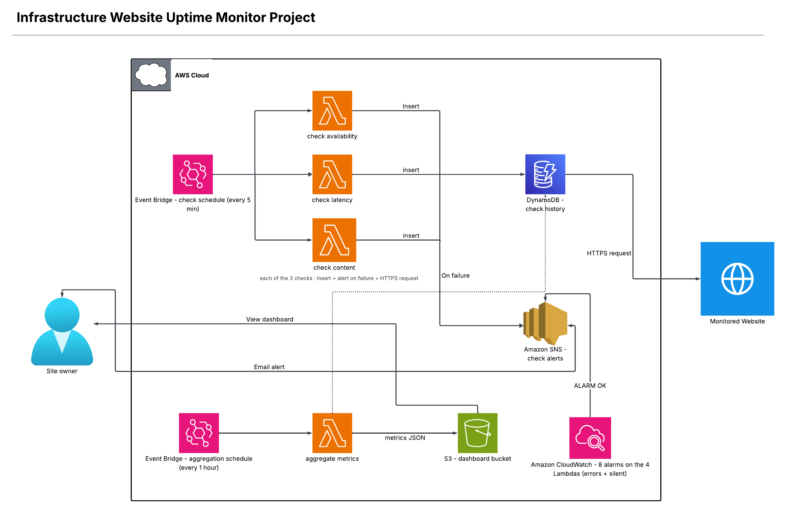

# Architecture

The diagram shows the three parts that make up the system.

## Monitoring pipeline

An EventBridge rule triggers the 3 check Lambdas (availability, latency, content) every 5 minutes. Each one sends an HTTPS request to the monitored site, saves the result in the `check history` DynamoDB table, and publishes an alert on the SNS topic if it fails. SNS then sends an email to the site owner. When several checks fail together they share one incident board in the same DynamoDB table so the owner get one email when it opens and one when it is solved. See [incident-management.md](incident-management.md).

## Dashboard pipeline

A second EventBridge rule, independent from the first one, triggers the `aggregate metrics` Lambda. It reads the history from DynamoDB, calculates the metrics for the current month and writes the result to a `metrics.json` file on the dashboard S3 bucket. The dashboard is checked separately by the site owner.

## Alarms

CloudWatch watch the 4 Lambdas with 8 alarms. Two alarms per Lambda. The first one trigger when the Lambda end with an error. The second one trigger when the Lambda does not run at all for 3 periods in a row for example if EventBridge is broken. Both use the same SNS topic as the checks so the owner get the ALARM and the OK emails in the same inbox. The alarms are independent from the incident board. See [testing-lambda-alarm.md](../testing/manual/testing-lambda-alarm.md).

## Why the monitoring and dashboard are separate

The checks and the metrics aggregation don't need to run at the same frequency: the checks need to be reactive (every 5 minutes) to catch an outage fast, while the dashboard doesn't need to be updated as often. Splitting the two avoids recalculating the metrics on every single check.
