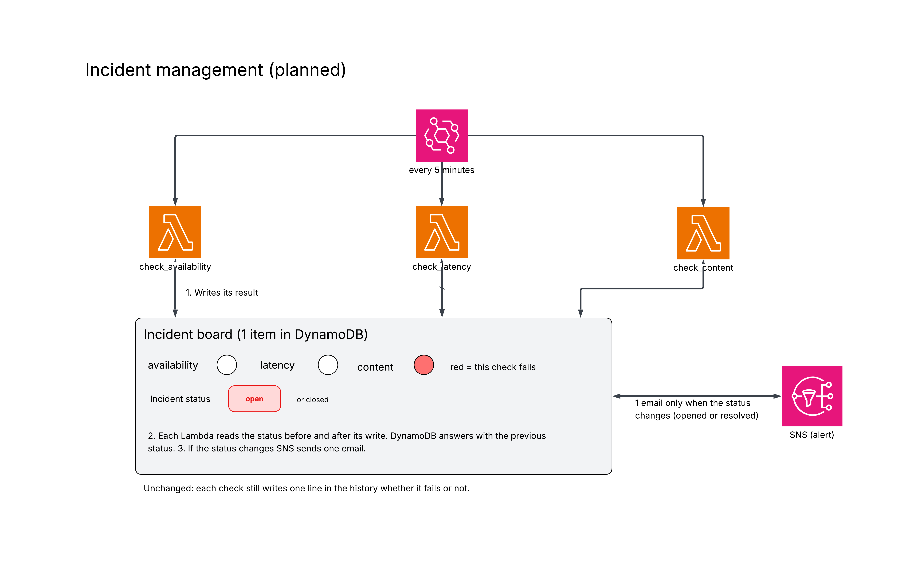

# Incident management

This groups the alerts from the 3 checks into one single incident instead of one email per check. Built and tested, see [testing-incident-management.md](../testing/manual/testing-incident-management.md) for the real test on the live site.

## The problem

Each check used to send its own email as soon as it fail. If the site go down the three checks fail at the same time so up to 3 emails arrive every 5 minutes for only one outage. The alerts become just like noise and nothing say when the problem is solved.

## The idea

An incident is one outage seen as a whole. The goal is to get only one email when it opens and only one when it is resolved and nothing between the two.

For that the three Lambdas share one item in DynamoDB which is the incident board. Each Lambda writes the result of its own check there with a switch and the switch is on when the check fails. The board also says if an incident is open or closed. The Lambdas don't talk to each other but they all read and write the same board so each one can adapt to what the others did.

## The rules

| Situation | What happens |
| --- | --- |
| A check fails, no incident is open | The incident opens, one email is sent |
| A check fails, an incident is already open | Nothing |
| A check succeeds, some switches are still on | Nothing, the incident stays open |
| The three checks succeed, an incident is open | The incident closes, one email is sent |

The incident opens at the first failure without waiting for a confirmation. The site is not a real site so a real problem will last and trigger the alert anyway. The downside is that a small one-time glitch would send two emails which are opened and then resolved. I accept that.

The closing is strict. When the page content is broken the site still answers which means the availability check succeeds while the content check fails. If availability could close the incident we would receive a false "resolved" email and this is dangerous because it creates a false feeling of safety while the problem is still there. It would also confuse the owner who looks at the history to understand what happened. Therefore the incident closes only when the three checks are back to normal.

When the three checks fail in the same second DynamoDB handles the writes one by one and tells each Lambda what the status was before. Only the first one hears "closed" so only that one sends the opening email. Confirmed in the real test: when `index.html` got deleted, the 3 checks failed together but `opened_by` in DynamoDB only shows the first one that reached the board.

## What the emails say

The opening email gives the check that detected the incident and its error message. If the message says the site is unreachable the email adds that the other checks are probably affected too because the whole site is down. The resolved email lists all the checks affected during the incident with their last message.

## What changed

The three check Lambdas now use a shared file called `incident.py` instead of their old alert code. One more IAM action was needed which is `dynamodb:UpdateItem` and the tests got updated, with 10 new tests just for `incident.py`. Nothing changed for `aggregate_metrics`, the dashboard, the history and EventBridge.

## Known limit

If the code of a Lambda crashes it writes nothing on the board and sends nothing. A CloudWatch alarm on the Lambda errors is planned separately.

## Schema

