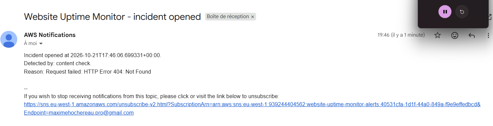
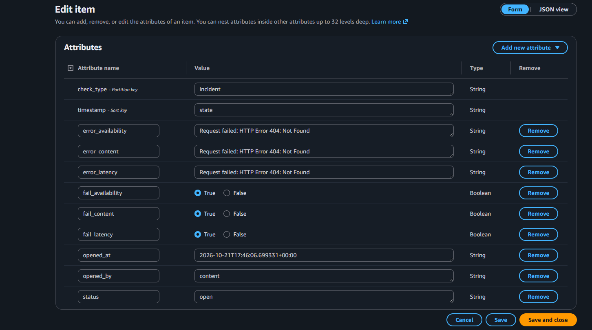
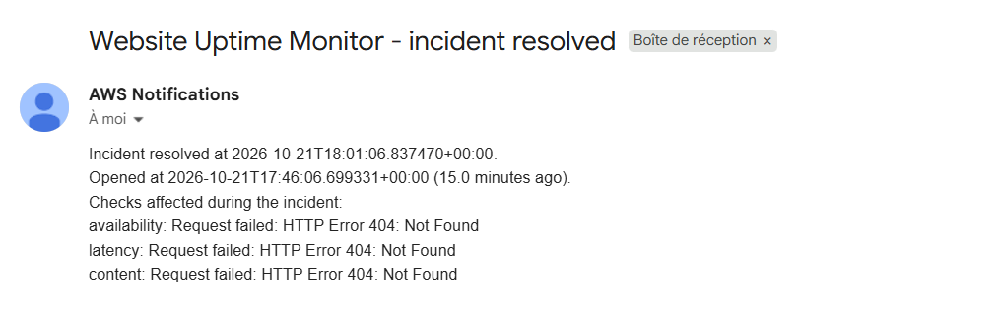
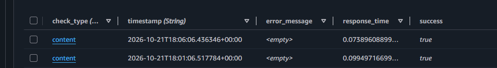

# Testing incident management - Website Uptime Monitor

The 3 Lambdas test (`testing-3-lambdas.md`) showed a limitation: when the site is fully down the 3 checks fail at the same time and each one send its own email so up to 3 notifications arrive for what is actually one single incident. This test check that the fix works: one incident one opened email one resolved email.

## Test: full site outage

Same method than before we delete `index.html` from the S3 bucket. This make all 3 checks fail at the same time since the page is simply not there anymore.

A few minutes later only one email arrive not 3. It say which check detected the problem first and why:

In DynamoDB the incident board (`check_type = "incident"`, `timestamp = "state"`) show the real picture: `fail_availability` `fail_latency` and `fail_content` are all `true` but the incident only opened once by the first check that failed:

## Fixing the site

We run `terraform apply` again to recreate `index.html`. At the next check the 3 Lambdas find the site healthy again. The board closes and one single resolved email get sent with a summary of every check that was affected during the incident:

The history in DynamoDB confirm it too the content check is back to `success = true`:

## Result

The deduplication works like expected. A full outage used to send up to 3 emails now it sends exactly 2: one when the incident opens one when it closes no matter how many checks are affected in between.
