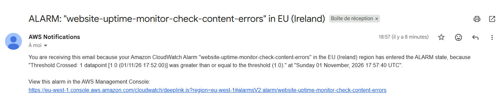
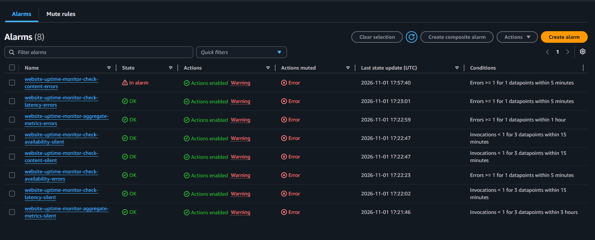
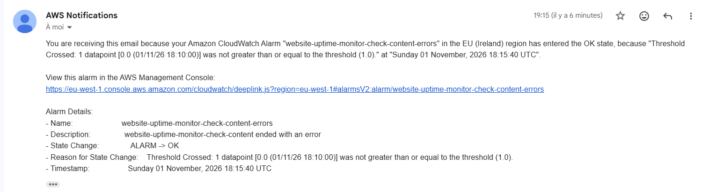
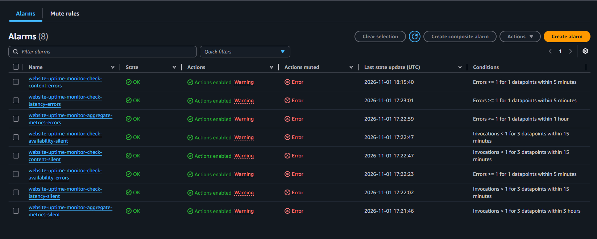

# Testing Lambda alarms - Website Uptime Monitor

The incident management test left a blind spot (see `incident-management.md`, "When a Lambda crashes"): if the code of a Lambda crashes it writes nothing on the board and sends nothing. The owner would never know that the monitoring itself is broken. This test checks that the CloudWatch alarms catch it.

## What is watched

Each of the 4 Lambdas has 2 alarms so 8 in total. They send to the same SNS topic as the site alerts. The "errors" alarm goes off when the Lambda runs but ends with an error. The "silent" alarm goes off when the Lambda did not run at all for 3 periods in a row, which is 15 minutes for the checks and 3 hours for aggregate_metrics. Both send a second email when the state goes back to OK.

When the alarms are created each one sends an OK email once, because it goes from no data to OK. This is normal and it never comes back.

The deployer user also got a new IAM statement to manage these alarms, only the ones with a name starting with the project name.

## Test: crash a Lambda on purpose

To get a real error I point `check_content` to a DynamoDB table that does not exist (one line in `lambda_checks/main.tf`) and run `terraform apply`. At the next run the Lambda cannot save its result and crashes. A few minutes later one email arrives:

In the CloudWatch console only `check-content-errors` is in alarm and the 7 others stay OK. This includes `check-content-silent`: the Lambda still runs, it just crashes. So a crash and a silence are two different cases and each one has its own alarm.

## Fixing the Lambda

I put the real table name back and run `terraform apply` again. At the next run the Lambda works and the alarm goes back to OK with a second email:

The 8 alarms are back to OK:

## Result

A Lambda crash that was invisible before now sends an email after a few minutes and another one when it is fixed.

Two things to know. The email is the raw CloudWatch text so it is less clean than the incident emails. The alarms are also separate from the incident board: a crash sends its own email but it does not open an incident.
